# BlockVerify: A Hybrid On-Chain/Off-Chain Product Authentication System with Chain-of-Custody Verification, Evaluated Against a Centralized Baseline

Mayank Balmoori¹, Kushal Agrawal¹, Jeevesh Malhotra¹, Dr. Sivaranjani A²

¹*School of Computer Science and Engineering, Vellore Institute of Technology, Vellore, India*  
²*Guide, School of Computer Science and Engineering, Vellore Institute of Technology, Vellore, India*

GitHub: https://github.com/KushalAgrawal30/BlockVerify

---

## Abstract

Counterfeit goods accounted for USD 467 billion of world trade in 2021, and
centralized anti-counterfeiting databases ask consumers to trust the very party
whose records are in question. This paper presents BlockVerify, a product
authentication system that stores product identity and ownership history in
Solidity smart contracts on an Ethereum-compatible network while keeping user
accounts, roles and sessions in MongoDB. Each registered product is bound to a QR
code encoding only a contract address and product identifier, so every scan
forces a fresh on-chain read rather than trusting data embedded in the label.
Verification does not read a stored authenticity flag; it re-derives authenticity
by replaying the transfer log and confirming that the chain of custody terminates
at the recorded owner. To test the project's central claim rather than assert it,
an equivalent MongoDB-only implementation was built and both systems were
measured over 30 trials per operation. The centralized baseline is 21.9× faster
to register, 25.0× faster to transfer and sustains 45.8× the verification
throughput, while BlockVerify detects 4 of 4 tamper attacks against the
baseline's 2 of 4. Both systems reject application-level attacks identically; the
difference appears only against an adversary with direct storage access. The
measured conclusion is therefore a trade-off, not a win: blockchain costs
approximately an order of magnitude in write latency and throughput, and buys
detection of the one attack class a centralized system structurally cannot detect.

**Keywords:** blockchain, product authentication, supply chain, smart contracts, chain of custody, counterfeit detection

---

## I. Introduction

Counterfeiting is a structural problem in global trade rather than a marginal
one. The OECD and EUIPO report that trade in counterfeit goods reached USD 467
billion in 2021, equal to 2.3% of world trade, of which USD 117 billion entered
the European Union alone — 4.7% of all EU imports [1]. Clothing, footwear and
leather accessories made up 62% of seized goods, and 65% of seizures moved
through small parcels and postal channels that evade conventional inspection [1].
Counterfeit trade value has remained near USD 460–510 billion across three
successive reporting cycles, so the problem is not receding.

**Problem statement.** Genuine products carry no tamper-proof digital identity.
Conventional product databases are single points of failure whose records can be
altered, deleted or spoofed by any party with backend access. Customers,
retailers and distributors have no fast, reliable way to confirm a product's
origin before purchase or resale, and there is no transparent, auditable trail
linking a product from manufacturer through distributor and retailer to customer.

**Motivation.** In pharmaceuticals and electronics, counterfeiting is a safety
problem rather than only a commercial one. Centralized anti-counterfeiting
systems ask the consumer to trust a company's own database — the consumer must
believe that the record has not been edited by the party with the strongest
incentive to edit it. A blockchain, whose defining property since its introduction has been an
append-only chain no single party can unilaterally rewrite [13], removes that
leap of faith by making the record itself provably unaltered since written.

**Research gap.** Prior work, reviewed in Section II, is predominantly
single-domain, rarely pairs on-chain critical data with off-chain non-critical
data in one deployable architecture, and seldom combines cost benchmarking with a
complete ownership-transfer workflow in the same system. Most significantly for
this paper, published work asserts blockchain's tamper-resistance advantage
without measuring it against an equivalent centralized implementation under
identical conditions.

**Objectives.** (i) Design smart contracts registering products with immutable
digital identities; (ii) auto-generate and bind a unique QR code to every
registered product; (iii) enable instant verification by QR scan; (iv) implement
contract-governed ownership transfer; (v) maintain a transparent, auditable
ownership history; (vi) build role-based interfaces for all four supply-chain
actors; and (vii) demonstrate — by measurement — blockchain's advantage over a
conventional centralized database.

**Contribution.** This paper's contribution is primarily evaluative. We implement
a complete hybrid-architecture prototype, and then implement a second,
functionally equivalent centralized system specifically so that objective (vii)
can be tested rather than claimed. We report latency distributions, a gas model
reconciled to the EVM cost specification to the exact gas unit, storage figures
read from node state, and a four-attack tamper comparison. The resulting finding
is narrower than the project's own original framing, and we report it as measured.

**Organization.** Section II reviews related work. Section III presents the
methodology, including architecture, formal model and algorithms. Section IV
describes the experimental setup, Section V the results, and Section VI the
comparison with existing work. Section VII analyses and interprets the results,
and Section VIII concludes.

---

## II. Related Work / Literature Survey

**Foundational and cross-domain studies.** Dasaklis et al. [2] conduct a
systematic literature review of blockchain-based applications across published
and grey literature, classifying application areas and open issues, and
motivating domain-specific anti-counterfeiting models rather than general-purpose
ones. Biswas et al. [3] combine a literature review with a prototype for
supplement goods, summarising toolsets for counterfeit detection and proposing a
blockchain system for identifying fake protein supplements. A survey of
QR-based anti-counterfeiting [4] reviews decentralized authentication frameworks
that link physical goods to immutable ledger records through QR codes, and a
comparative review [5] evaluates blockchain against AI- and RFID-based methods,
identifying cost and rigidity limits in the latter two and positioning blockchain
as the more decentralized alternative.

**Applied systems and domain-specific implementations.** A review of academic
models and industry pilots [6] surveys real-world deployments and flags
technical-expertise barriers to adoption. Closest to our own workflow, an
ICACC 2022 paper [7] demonstrates a working QR-based pipeline from registration
through ship-to-distributor and ship-to-retailer to end-user verification.
A further study [8] defines a full smart-contract workflow for identifier
generation, on-chain transaction recording and verification interfaces.

**Emerging techniques and cost benchmarking.** Ganga Parvathi et al. [9] combine
ERC-721 product tokenization with a CNN image classifier, reporting 94.2%
classification accuracy and a 95.3% true-verification rate and demonstrating
hybrid AI-plus-blockchain feasibility. Tran-Truong et al. [10] secure a
pharmaceutical supply chain using Ethereum smart contracts with hash-anchored
off-chain storage, explicitly to reduce on-chain storage cost. An Ethereum-based
product identification system [11] benchmarks smart-contract identifiers on gas
and ether cost, which directly informs feasibility at student scale.

*Table I. Summary of related work and its relation to the present study.*

| Ref. | Approach | Key contribution | Relation to this work |
| --- | --- | --- | --- |
| [2] | Cross-domain systematic review | Classified applications and open issues | Motivates a domain-specific model |
| [3] | Review plus supplement-goods prototype | Toolsets for counterfeit detection | Single-domain; we generalise |
| [4] | Survey of QR-based anti-counterfeiting | Reviewed QR-to-ledger frameworks | Confirms QR-as-locator design |
| [5] | Blockchain vs. AI vs. RFID review | Cost and rigidity limits of AI/RFID | Supports hardware-free approach |
| [6] | Review of models and industry pilots | Adoption and expertise barriers | Motivates low-complexity stack |
| [7] | QR enrollment-to-verification prototype | End-to-end pipeline demonstrated | Closest comparator to our workflow |
| [8] | Smart-contract architecture | ID generation and verification interfaces | Comparable contract design |
| [9] | ERC-721 plus CNN classifier | 94.2% accuracy, 95.3% true verification | Compared in Table IX |
| [10] | Ethereum plus off-chain hashing | Reduced on-chain storage cost | Compared in Table IX |
| [11] | Gas and ether cost benchmarking | Concrete cost benchmarks | Compared in Table IX |

**Research-gap statement.** Across [2]–[11], three gaps persist. First, most
systems are single-domain and few offer a generalized, low-cost model replicable
by a small team. Second, few pair on-chain critical data with off-chain
non-critical data such as authentication and profiles within one lightweight
deployable architecture. Third, and central to this paper, none of the reviewed
works implements an equivalent centralized system and measures both under
identical conditions; tamper resistance is argued from the properties of
blockchain rather than demonstrated comparatively. BlockVerify addresses the
first two by construction and the third by experiment.

---

## III. Proposed Methodology

### A. System Architecture

BlockVerify is organised into four layers, shown in Fig. 1. The presentation
layer is a React application providing role-specific portals and a camera QR
scanner. The application layer is an Express API performing authentication, role
enforcement, Ethers.js contract interaction and QR generation. The blockchain
layer holds `OwnershipTransfer`, which inherits `ProductRegistry`, deployed as a
single contract instance. The off-chain data layer is MongoDB, holding users,
roles and sessions and no product data whatsoever.

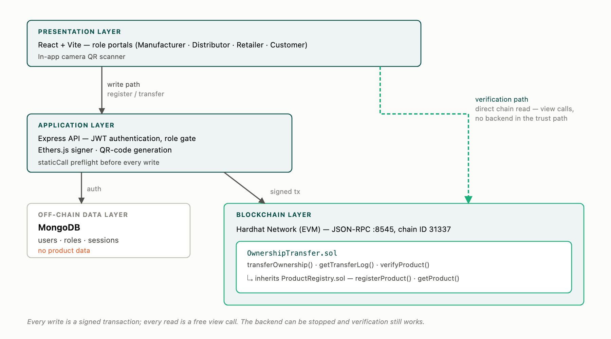

*Fig. 1. BlockVerify four-layer architecture, showing the write path through the
API and the verification path that reads the contract directly.*

The architecturally significant feature in Fig. 1 is that two distinct paths
exist. Writes travel React → Express → Ethers.js signer → JSON-RPC node →
contract, with MongoDB supporting authentication alongside. Verification travels
React → JSON-RPC node → contract read methods, bypassing the API entirely.
The backend is therefore a convenience for writes and is never in the trust path
for reads; it can be stopped and verification continues to function.

### B. Workflow

Fig. 2 shows the end-to-end sequence. A manufacturer registers a product, a QR
code is generated and affixed, custody moves down the chain by contract call at
each hop, and any party verifies by scanning.

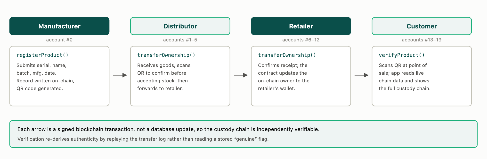

*Fig. 2. End-to-end workflow across the four supply-chain roles. Each arrow is a
signed blockchain transaction rather than a database update.*

### C. Dataset

The demonstration dataset comprises 25 products across three batches (`BATCH-A`,
`BATCH-B`, `BATCH-C`) drawn from five pharmaceutical product names, with custody
deliberately staggered — two held by the customer, three by the retailer, five by
the distributor and fifteen by the manufacturer — so that every supply-chain
stage is represented simultaneously. Four demonstration users represent the four
roles. Each benchmark run registers a further 30 products with unique serials.
Contract unit tests construct independent fixtures against a freshly deployed
contract, so they depend on neither the seed data nor each other. This is a
functional-testing dataset and is not a statistical sample of real counterfeit
incidence.

### D. Smart Contract Design

`ProductRegistry` defines the product record given in Table II and two mappings:
`products`, keyed by identifier, and `serialUsed`, keyed by the Keccak-256 hash
of the serial number. Hashing the serial rather than storing it keeps the
uniqueness check to a single 32-byte slot at constant cost regardless of serial
length. `OwnershipTransfer` inherits the registry and adds `transferLog`, a
per-product append-only array of `{from, to, timestamp}` hops, together with
`transferOwnership`, `getTransferLog` and `verifyProduct`. Inheritance keeps the
separation of concerns visible in source while deploying one contract instance,
avoiding a second address and a cross-contract authorization problem.

*Table II. On-chain product record.*

| Field | Type | Description |
| --- | --- | --- |
| `productId` | `uint256` | Unique, auto-incremented at registration |
| `name` | `string` | Product name |
| `manufacturer` | `address` | Wallet of the registering manufacturer |
| `batchNumber` | `string` | Production batch identifier |
| `mfgDate` | `uint256` | Manufacturing timestamp |
| `currentOwner` | `address` | Updated on every transfer |

### E. Data Security and Privacy Model

The on-chain/off-chain split is a privacy decision as much as a cost one. The
chain is a permanent public record, so it holds only product provenance:
identifier, name, manufacturer address, batch, manufacturing date, current owner
and the transfer log. No personally identifying information is written on-chain.
MongoDB holds names, email addresses, bcrypt password hashes, role assignments
and session tokens — data that must remain correctable and erasable, and which
nobody needs to audit independently.

Authentication uses JWTs signed with HMAC-SHA256; passwords are stored only as
bcrypt hashes with a work factor of 10. Authorization is enforced at two tiers:
an off-chain role gate restricting registration to manufacturers, and an
on-chain `require` restricting transfer to the current owner. The second is
authoritative. A caller who bypasses the API entirely and submits a transaction
directly is still constrained by the contract, which is the property the
centralized baseline cannot replicate.

### F. Mathematical Model

**1) Hash computation and uniqueness.** Let *s* be a serial number and
*H* = Keccak-256. The uniqueness key is *k* = *H*(*s*). With
*U* : {0,1}²⁵⁶ → {0,1} the used-serial predicate, registration of *s* is
admissible if and only if *U*[*H*(*s*)] = 0, after which *U*[*H*(*s*)] ← 1. The
check is O(1) in serial length.

**2) Transaction validation.** A transaction τ = (*n*, *g*, *p*, *to*, *v*, *d*, σ)
is accepted by the network only if `ecrecover`(*h*(τ), σ) yields a sender *a*
whose account nonce equals *n* and whose balance covers *g*·*p* + *v*. Authorship
of every hop is therefore established by the network before contract code runs;
the contract need not re-verify signatures.

**3) Authentication.** A session token is
*t* = *b*(*h*) ‖ *b*(*P*) ‖ MAC, where *h* is the token header, *P* the payload,
*b*(·) base64url encoding and MAC = HMAC-SHA256(*K*, *b*(*h*) ‖ *b*(*P*)). The
token is accepted only if the MAC recomputes under the server key *K* and the
expiry claim in *P* has not elapsed.

**4) Access-control model.** Let *P* be the product set and *A* the address
space, with owner : *P* → *A* and mfr : *P* → *A*. A transfer of *p* to *a*′ by
caller *c* is permitted if and only if

> mfr(*p*) ≠ 0 ∧ owner(*p*) = *c* ∧ *a*′ ∉ {0, *c*}

and registration of serial *s* by user *u* is permitted if and only if

> role(*u*) = Manufacturer (off-chain) ∧ *U*[*H*(*s*)] = 0 (on-chain).

**5) Verification function.** Let the transfer log of *p* be
*L*(*p*) = ⟨(*f*<sub>1</sub>,*t*<sub>1</sub>,·), …, (*f*<sub>h</sub>,*t*<sub>h</sub>,·)⟩ and define *c*<sub>0</sub> = mfr(*p*),
*c*<sub>i</sub> = *t*<sub>i</sub>. Then

> *V*(*p*) = 0 if mfr(*p*) = 0;
> *V*(*p*) = 2 if ∃ *i* ≤ *h* : *f*<sub>i</sub> ≠ *c*<sub>i−1</sub>, or if *c*<sub>h</sub> ≠ owner(*p*);
> *V*(*p*) = 1 otherwise,

where 0, 1 and 2 denote NOT REGISTERED, VERIFIED GENUINE and OWNERSHIP MISMATCH.
*V* runs in O(*h*) and reads no stored authenticity flag.

**6) Storage overhead.** With 32-byte slots, a product occupies six slots (one
per field, short strings packing inline) plus one for the uniqueness guard, and a
non-empty log adds one length slot and three slots per hop:

> *S*(*p*) = 32 · (7 + 𝟙[*h* > 0]·(1 + 3*h*)) bytes.

Hence 224 bytes at *h* = 0 and 544 bytes at *h* = 3.

**7) Gas model.** For a state-changing call with calldata *d*,

> *G* = *G*<sub>tx</sub> + 16·|*d*|<sub>nz</sub> + 4·|*d*|<sub>z</sub> + Σ<sub>j</sub> *G*<sub>sstore</sub>(*j*) + *G*<sub>log</sub> + *G*<sub>exec</sub>,

where |*d*|<sub>nz</sub> and |*d*|<sub>z</sub> count non-zero and zero calldata
bytes respectively, *G*<sub>tx</sub> = 21,000, and *G*<sub>sstore</sub> = 20,000
for a zero→non-zero write and 5,000 otherwise, plus 2,100 for the first (cold)
access to a slot under EIP-2929 [14].
Two consequences are directly testable. The premium for the first write to a
counter slot is (20,000 − 5,000) + 2,100 = 17,100 gas, and each additional
non-zero calldata character displaces a zero padding byte at a net cost of
16 − 4 = 12 gas. Section V reports both as measured.

**8) Latency and throughput.** For *n* sequential trials with latencies
*t*<sub>1</sub>…*t*<sub>n</sub>, we report the order statistics median and *p*<sub>95</sub> rather than the mean
alone, since tail behaviour determines perceived responsiveness. Throughput for a
single sequential client is Θ = *n* / Σ *t*<sub>i</sub>, and the ratio between systems is
*R* = Θ<sub>centralized</sub> / Θ<sub>blockchain</sub>.

### G. Algorithm / Pseudocode

```
Algorithm 1: verifyProduct(productId) -> (status, owner, hops)
 1  record  <- products[productId]
 2  if record.manufacturer = 0 then
 3      return (NOT_REGISTERED, 0, 0)
 4  log     <- transferLog[productId]
 5  cursor  <- record.manufacturer
 6  for i <- 1 to |log| do
 7      if log[i].from != cursor then
 8          return (OWNERSHIP_MISMATCH, record.currentOwner, |log|)
 9      cursor <- log[i].to
10  if cursor != record.currentOwner then
11      return (OWNERSHIP_MISMATCH, record.currentOwner, |log|)
12  return (VERIFIED_GENUINE, record.currentOwner, |log|)
```

```
Algorithm 2: registerProduct(serial, name, batch, mfgDate) -> productId
 1  k <- keccak256(serial)
 2  require not serialUsed[k]            // duplicate guard
 3  require |name| > 0
 4  serialUsed[k] <- true
 5  productId <- ++productCount
 6  products[productId] <- (productId, name, msg.sender, batch, mfgDate, msg.sender)
 7  emit ProductRegistered(productId, serial, msg.sender, batch, mfgDate)
 8  return productId
```

```
Algorithm 3: transferOwnership(productId, to)
 1  p <- products[productId]
 2  require p.manufacturer != 0                      // registered
 3  require p.currentOwner = msg.sender               // authorised
 4  require to != 0 and to != msg.sender              // valid recipient
 5  p.currentOwner <- to
 6  transferLog[productId].append((msg.sender, to, block.timestamp))
 7  emit OwnershipTransferred(productId, msg.sender, to, block.timestamp)
```

### H. Implementation Details

**Blockchain platform.** Ethereum; standard EVM bytecode portable without
modification to any EVM-compatible network, including a Polygon Layer-2.

**Smart contracts.** `ProductRegistry.sol` and `OwnershipTransfer.sol`, Solidity
0.8.24, compiled to the Paris EVM target. Solidity 0.8.x was chosen because
arithmetic overflow checking is built into the compiler, removing a vulnerability
class without an external library.

**Programming languages.** Solidity for contracts; JavaScript (Node.js 24.13.0)
for the backend, tests, benchmarks and the baseline; JSX for the frontend.

**Wallets.** Twenty externally-owned accounts derived from Hardhat's published
test mnemonic on path `m/44'/60'/0'/0/{i}`, mapped to roles as account #0
Manufacturer, #1–5 Distributor, #6–12 Retailer, #13–19 Customer.

**QR binding.** Each code encodes `{contractAddress, productId}` and no product
attributes, so every scan triggers a fresh chain read.

**Preflight.** Every state-changing call is dry-run with `staticCall` before
broadcast. This surfaces the true revert reason, which a failed send discards,
and prevents a failed send from leaving the signer's nonce ahead of the chain. It
does not reserve state, so send-time failure must still be handled.

**Browser RPC access.** The Hardhat node advertises only `OPTIONS` and `GET` in
its CORS preflight, so the browser cannot `POST` to it directly; Vite proxies the
frontend RPC path as a transparent development pass-through that makes no
verification decisions.

---

## IV. Experimental Setup

*Table III. Experimental environment.*

| Parameter | Value |
| --- | --- |
| Platform / network | Ethereum; Hardhat Network [15], chain ID 31337, automatic mining |
| RPC endpoint | `http://127.0.0.1:8545` |
| Deployed contract | `OwnershipTransfer` at `0x5FbDB2315678afecb367f032d93F642f64180aa3` |
| Compiler | `solc` 0.8.24, Paris target |
| Runtime | Node.js 24.13.0, npm 11.6.2 |
| Database | MongoDB — `blockverify`, `blockverify-baseline` |
| Services | API `:4000`, baseline `:4001`, frontend `:5173`, MongoDB `:27017` |
| Host | Apple silicon MacBook Air, macOS |
| Trials per operation | 30, sequential, single client |

*Table IV. Tools and libraries.*

| Layer | Technology |
| --- | --- |
| Contracts | Solidity 0.8.24 |
| Framework | Hardhat 2.22.x with `@nomicfoundation/hardhat-toolbox` |
| Client library | Ethers.js 6.17.0 |
| Backend | Express, Mongoose, `qrcode`, `jsonwebtoken`, `bcryptjs` |
| Frontend | React 19, Vite, `html5-qrcode` |
| Testing | Mocha and Chai via Hardhat |

**Baseline implementation.** The centralized comparator implements the same
workflow with MongoDB as the sole source of truth and no blockchain component. It
uses an indexed collection, a unique index on serials, server-side owner
authorization, and *the same replay-based verification algorithm* as the
contract. This matters methodologically: the difference under measurement is
architectural, not an artefact of one implementation being written carelessly.

**Metrics and justification.** Latency is reported as median and *p*<sub>95</sub> because
tail latency, not the mean, governs perceived responsiveness at a point of sale.
Gas is reported because it is the direct cost of writing provenance and is the
figure that determines production feasibility. Throughput is reported because
verification is the high-frequency operation. Tamper detection rate is reported
because it is the property the architecture exists to provide.

---

## V. Results

### A. Functional and Security Testing

Nine Hardhat/Chai tests pass, shown in Fig. 3, covering registration,
duplicate-serial rejection, multi-hop transfer, unauthorized-transfer rejection,
transfer of an unregistered product, and all three branches of `verifyProduct`.

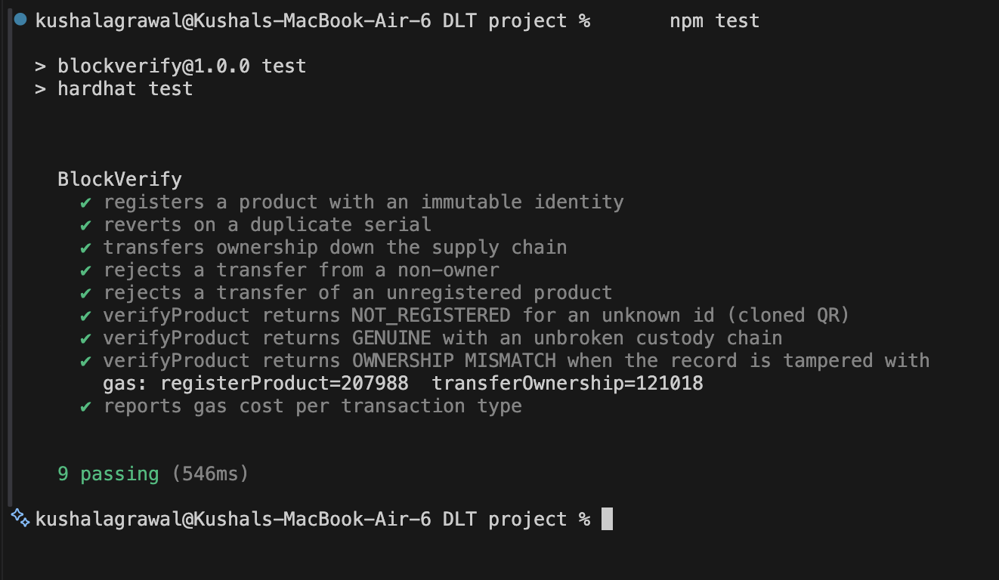

*Fig. 3. Contract test suite: nine passing tests with per-transaction gas output.*

The `OWNERSHIP MISMATCH` branch is unreachable through the contract's own
functions — no sequence of legitimate calls can make the transfer log disagree
with `currentOwner`. It is therefore exercised by forcing node storage with
`hardhat_setStorageAt`. A branch that cannot be reached legitimately must still
be proven correct, because its purpose is to fire when something illegitimate has
occurred.

### B. Transaction Details

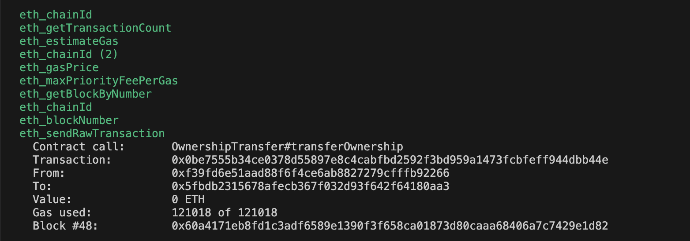

*Fig. 4. A mined `transferOwnership` transaction showing hash, sender, recipient
contract, gas used and block number.*

Fig. 4 shows that each ownership change is a signed transaction with a hash, a
gas figure and a block number. The node distinguishes `eth_sendRawTransaction`,
which is mined and consumes gas, from `eth_call`, the `view` reads used by
verification, which execute locally and appear with no gas or block number.

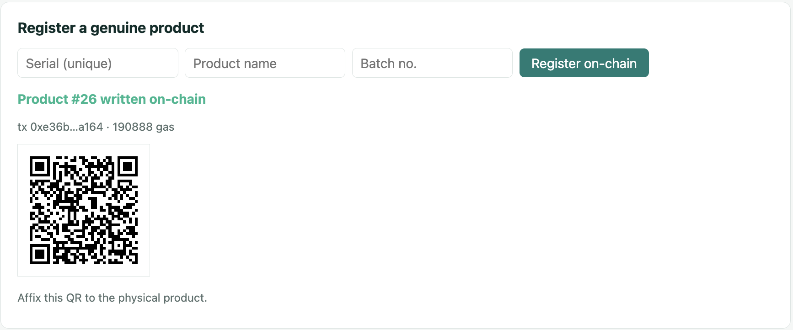

*Fig. 5. Product registration: on-chain write returning product identifier,
transaction hash, gas consumed and the generated QR code.*

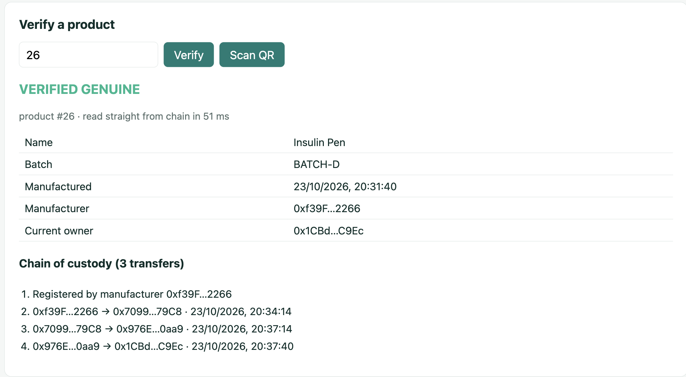

*Fig. 6. Verification returning VERIFIED GENUINE with product fields and the
complete three-hop chain of custody, read directly from the chain in 51 ms.*

Fig. 6 is the system's principal output and evidences objectives (iii), (iv) and
(v) simultaneously. Figs. 7 and 8 show the two rejection cases.

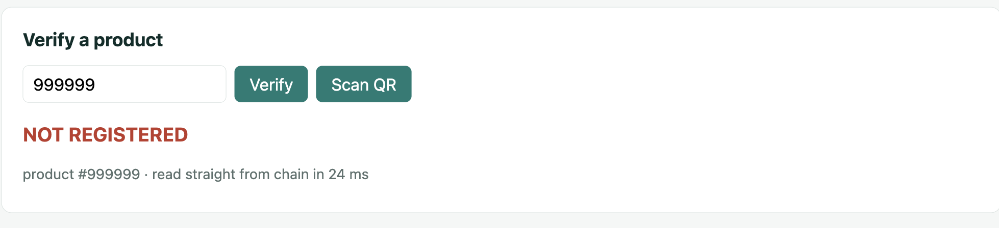

*Fig. 7. Verification of an unregistered identifier, the cloned-or-invented QR case.*

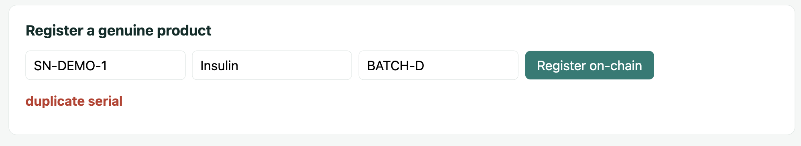

*Fig. 8. Duplicate serial registration rejected by contract revert.*

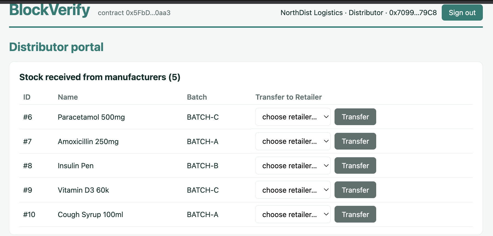

*Fig. 9. Role-based interface: the Distributor portal showing stock in custody
and the next-hop transfer control.*

### C. Performance

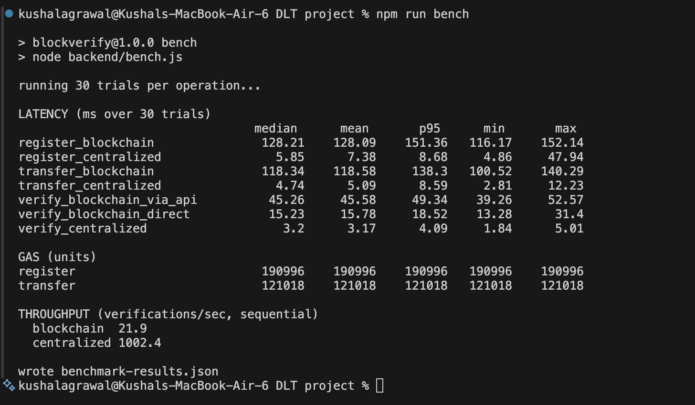

*Fig. 10. Benchmark output: 30 trials per operation across both systems.*

*Table V. Operation latency in milliseconds over 30 trials.*

| Operation | System | Median | Mean | *p*<sub>95</sub> | Min | Max |
| --- | --- | --- | --- | --- | --- | --- |
| Register | Blockchain | 128.21 | 128.09 | 151.36 | 116.17 | 152.14 |
| Register | Centralized | 5.85 | 7.38 | 8.68 | 4.86 | 47.94 |
| Transfer | Blockchain | 118.34 | 118.58 | 138.30 | 100.52 | 140.29 |
| Transfer | Centralized | 4.74 | 5.09 | 8.59 | 2.81 | 12.23 |
| Verify (via API) | Blockchain | 45.26 | 45.58 | 49.34 | 39.26 | 52.57 |
| Verify (direct read) | Blockchain | 15.23 | 15.78 | 18.52 | 13.28 | 31.40 |
| Verify | Centralized | 3.20 | 3.17 | 4.09 | 1.84 | 5.01 |

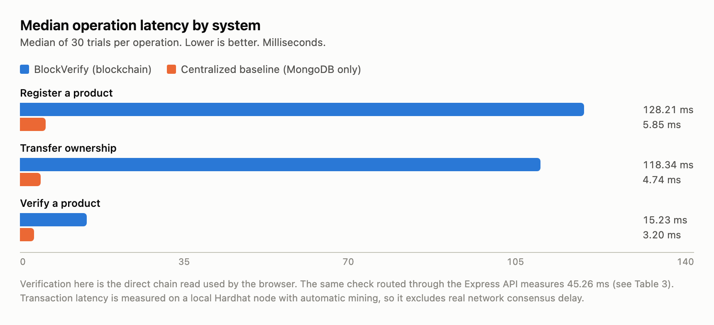

*Fig. 11. Median operation latency by system. Verification shown is the direct
chain read used by the browser.*

*Table VI. Gas consumption by operation and condition.*

| Operation | Gas | Condition |
| --- | --- | --- |
| Contract deployment | 1,577,877 | One-time |
| `registerProduct` | 207,988 | First registration on a fresh contract |
| `registerProduct` | 190,996 | Steady state, benchmark input strings |
| `registerProduct` | 190,888 | Steady state, interface input strings |
| `transferOwnership` | 121,018 | First transfer of a given product |
| `transferOwnership` | ≈103,910 | Subsequent transfers |
| `getProduct`, `getTransferLog`, `verifyProduct` | 0 | `view` functions |

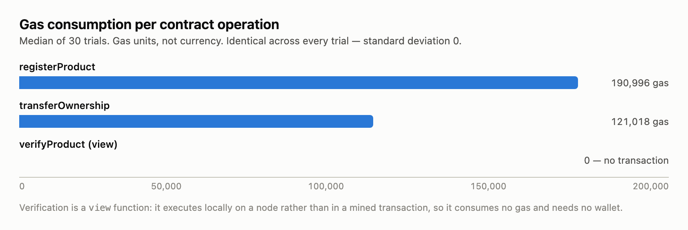

*Fig. 12. Gas consumption per contract operation. Standard deviation was zero
across all 30 trials.*

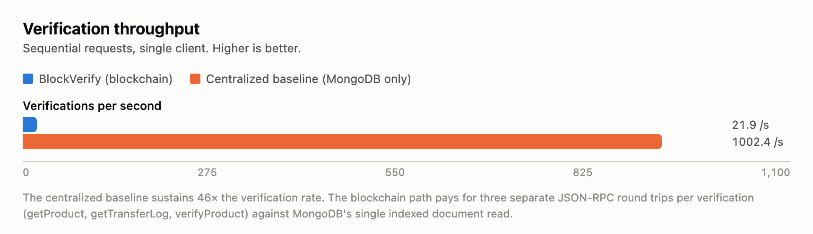

*Fig. 13. Verification throughput, sequential single client.*

*Table VII. Storage per product.*

| System | Product record | Per transfer hop | Product with 3 hops |
| --- | --- | --- | --- |
| Blockchain | 7 slots = 224 bytes | 3 slots = 96 bytes | 17 slots = 544 bytes |
| Centralized | 393 bytes (measured average) | Stored inline | 393 bytes (measured average) |

Storage figures for the blockchain system in Table VII were read directly from
node state rather than inferred, confirming the model of Section III-F-6.

### D. Tamper Resistance

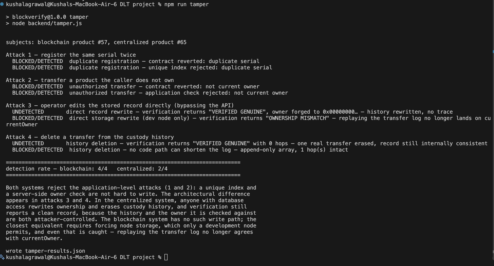

*Fig. 14. Tamper experiment output: four attacks executed against both systems.*

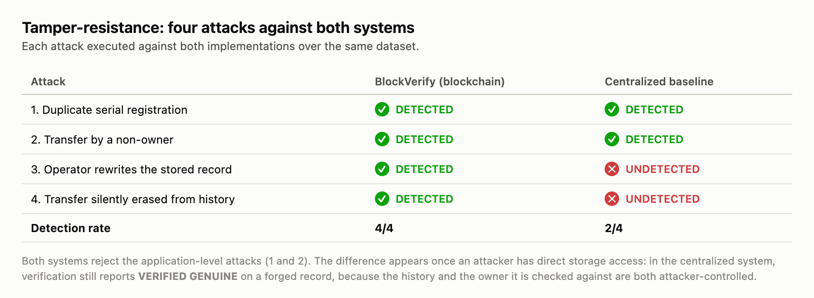

*Fig. 15. Tamper-resistance detection matrix. Blockchain detects 4 of 4;
the centralized baseline detects 2 of 4.*

*Table VIII. Tamper-attack outcomes.*

| Attack | Adversary | Blockchain | Centralized |
| --- | --- | --- | --- |
| 1. Duplicate serial registration | API client | Detected — contract revert | Detected — unique index |
| 2. Transfer by a non-owner | API client | Detected — contract revert | Detected — server check |
| 3. Operator rewrites the stored record | Storage access | Detected — OWNERSHIP MISMATCH | **Undetected — reports GENUINE** |
| 4. Transfer silently erased from history | Storage access | Detected — append-only log intact | **Undetected — reports GENUINE** |
| **Detection rate** | | **4/4** | **2/4** |

---

## VI. Comparison with Existing Work

*Table IX. Comparison against the centralized baseline and published approaches.*

| Parameter | BlockVerify (this work) | Centralized baseline (this work) | Parvathi et al. [9] | Tran-Truong et al. [10] | Ethereum product ID [11] |
| --- | --- | --- | --- | --- | --- |
| Trust model | Decentralized; reads need no trusted party | Operator must be trusted | Blockchain plus CNN | Blockchain plus off-chain store | Blockchain |
| Identity mechanism | QR locator to on-chain record | Database identifier | ERC-721 token plus image | On-chain hash anchor | Smart-contract identifier |
| Full transfer lifecycle | Yes, every hop on-chain | Yes, in-database | Not the paper's focus | Yes, track-and-trace | Identifier focus |
| Verification cost | 0 gas (`view`) | None | Not reported | Not reported | Gas benchmarked |
| Register / transfer gas | 190,996 / 121,018 | Not applicable | Not reported | Reduced via off-chain data | Benchmarked |
| Reported accuracy metric | 4/4 tamper detection | 2/4 tamper detection | 94.2% CNN accuracy; 95.3% true verification | Not reported | Not reported |
| Measured against a centralized baseline | **Yes** | — | No | No | No |
| Physical-item binding | QR only | Identifier only | Image classifier adds binding | QR/identifier | Identifier |
| Hardware requirement | Phone camera only | None | Camera plus trained model | None stated | None stated |

Three points of comparison deserve comment. Against our own centralized
baseline, BlockVerify is uniformly slower and uniformly more tamper-resistant,
quantified in Tables V and VIII. Against Parvathi et al. [9], our system has no
image-classification stage and therefore no comparable accuracy figure; their
94.2% CNN accuracy addresses physical-item binding, which is precisely the
weakness we identify in Section VII-C, so the approaches are complementary rather
than competing. Against Tran-Truong et al. [10] and the Ethereum identification
system [11], our contribution is not a lower gas figure — [10] explicitly reduces
on-chain cost by moving data off-chain, which we do not — but the comparative
evaluation that none of [9]–[11] performs.

---

## VII. Analysis and Discussion

### A. Interpretation of Results

**Why writes are 20–25× slower, and why the true gap is larger.** A contract
write incurs transaction construction, ECDSA signing, gas estimation, a
`staticCall` preflight, broadcast, mining and a receipt poll — six or more
JSON-RPC round trips where MongoDB performs one indexed write. Critically, the
measured figure *understates* the difference: Hardhat Network mines a block the
instant a transaction arrives, so the 128.21 ms median contains no consensus
delay at all. Ethereum mainnet requires roughly 12 seconds per block and several
blocks for practical finality; a Layer-2 such as Polygon, one to two seconds.
The 128 ms figure is therefore a floor achievable only on a development network,
and a production deployment would be three to four orders of magnitude slower on
writes. Any claim that this architecture competes with a database on write
latency would be false.

**Why verification is the operation that matters.** Registration and transfer
occur once per product per hop and are performed by businesses that can absorb
seconds of latency. Verification occurs on every scan, is performed by consumers
at the point of sale, and is the only operation a waiting person perceives. It is
also where the architecture is most favourable: a `view` call executes locally,
enters no block, costs no gas and requires no wallet. At a 15.23 ms median it is
within the threshold of apparent instantaneity, and it would remain so on a
public network because a `view` call does not await consensus. The operations
blockchain makes expensive are the infrequent ones; the frequent one is free.
This asymmetry is what makes the design viable at all. That verification through
the API costs 45.26 ms against 15.23 ms direct reinforces the point: the API is
not merely slower on that path, it is unnecessary, so excluding it from the trust
path is simultaneously the faster and the more trustworthy choice.

**Why gas is perfectly deterministic.** Standard deviation was exactly zero
across 30 trials. The EVM is a deterministic state machine whose per-opcode costs are published in
its formal specification [12], so identical input over identical state costs
identical gas. A single
reading therefore suffices for gas where it would be inadequate for latency. The
three distinct `registerProduct` figures in Table VI reconcile exactly to the
model of Section III-F-7: 207,988 − 190,888 = 17,100, matching
(20,000 − 5,000) + 2,100 for the first write to the counter slot under
EIP-2929 [14]; and 190,996 − 190,888 = 108, matching nine additional calldata
characters at the predicted 12 gas each. The first-transfer premium of
121,018 − 103,910 = 17,108 is the same effect applied to the log's length slot,
the residual eight gas arising from differing zero-byte counts in recipient
addresses.

**Why on-chain storage is smaller yet far more expensive.** Table VII shows 224
bytes on-chain against 393 bytes in MongoDB — the chain is more compact, because
BSON stores field names with every document while the contract stores bare slots
at computed addresses. Byte count is nevertheless the wrong cost measure. Those
224 bytes are replicated on every node and priced at 20,000 gas per fresh slot,
while MongoDB's 393 bytes exist once. The cost is a function of replication and
permanence, not size — which is precisely the resource being purchased.

**Why both systems scored identically on attacks 1 and 2.** This is the most
important interpretive result in the paper. A unique index rejects a duplicate
serial as reliably as a contract `require`, and a server-side owner check rejects
an unauthorized transfer as reliably as `require(currentOwner == msg.sender)`.
Blockchain conferred *no advantage whatsoever* on either. Any claim that a
blockchain is required to prevent duplicate registration is incorrect, and the
present project's own initial framing came close to implying it.

The advantage appears only against attacks 3 and 4, and only because of who the
adversary is. In the centralized system the verification algorithm is *identical*
to the contract's, yet it certifies a forged record, because both the history it
replays and the owner it checks against are attacker-controlled. The general
principle is that **a consistency check is only as trustworthy as the least
trustworthy party able to write to the data being checked.** The algorithm does
not provide the guarantee; the inability to rewrite its inputs does.

**On the integrity of the tamper experiment.** Our first implementation of
attack 4 erased the custody history but left `currentOwner` pointing at a forged
address. That record is internally inconsistent, the replay check caught it, and
the centralized system appeared to score 3/4. The attack was unrealistic: a
competent insider erases the history *and* resets the owner to the manufacturer,
leaving a consistent record stating that the product never left the factory.
Re-run correctly, the attack is undetected and the score is 2/4. We report this
because the weaker attack flattered our own hypothesis, and an evaluation that
tests only survivable attacks measures nothing.

**What the blockchain result does and does not establish.** Attack 3 against the
chain used `hardhat_setStorageAt`, which forces a storage slot directly. A public
Ethereum network offers no such facility; altering a deployed contract's storage
there would require rewriting history against network consensus. The attack is
possible here only because a development node deliberately exposes it for
testing. The result is therefore narrower than it appears but still meaningful:
even granting the adversary a power no real network grants, the forged record is
*detected*, because the transfer log no longer leads to `currentOwner`.
Verification fails safe rather than fails silent. Attack 4 is the stronger
structural finding — the log is append-only and no contract function shortens it,
so erasing a hop is not an operation the contract will perform at any privilege
level.

### B. Strengths

Verification requires no trust in the operator: the frontend reads the contract
directly, the API can be stopped entirely, and any third party with the contract
address and an RPC endpoint can audit any product without an account or our
cooperation. Verification is free and fast — zero gas, no wallet, 15.23 ms
median — so the operation consumers perform is the one the architecture makes
cheapest. History is append-only by construction rather than by policy, a
property of the code rather than an access rule an administrator may be persuaded
to bypass. Verification never trusts a stored flag but re-derives authenticity
from the custody chain. The QR encodes a locator rather than a claim, so forging
the label gains an adversary nothing. The gas model reconciles to the EVM
specification to the exact unit, as shown in Section VII-A. Finally, the system
is hardware-free: any phone camera is a verification terminal, with no RFID or
NFC infrastructure at any point in the chain.

### C. Limitations

Write performance is 20–25× worse, and as established above this understates the
production gap. Verification throughput is 45.8× lower, partly because our
implementation makes three JSON-RPC calls where one would suffice. The backend
holds all private keys: signing on users' behalf removes wallet friction from the
demonstration but means a compromised backend can transact as any participant,
which weakens the decentralization argument the system makes. A local network is
not a deployment — it offers instant finality, no gas price, no transaction
competition and no reorganizations.

Most significantly, the QR code can be copied. The chain proves a record's
integrity; it cannot prove that the physical object bearing the label is the
object the record describes. A counterfeit item carrying a photocopied genuine
label still verifies as genuine, and no cryptographic property addresses this.
Relatedly, scan-context checking is not implemented: comparing `currentOwner`
against the scanning party would flag a duplicated label, and the chain holds the
data to do so, but the interface does not yet perform the comparison. Finally,
immutability protects a record only after it is written — a manufacturer who
registers false batch information has recorded false information permanently and
verifiably — and all measurements derive from a single host, single client and
sequential requests, without concurrent load or network variance.

### D. Proposed Improvements

Batching verification into a single `verifyProductFull` call returning status,
product and log together would collapse three JSON-RPC round trips into one; this
is the clearest available throughput gain and requires no architectural change.
Replacing backend-held keys with MetaMask or WalletConnect signing would remove
the single point of compromise currently undermining the decentralization claim.
Deploying to Sepolia and Polygon Amoy and re-measuring would replace the floor
figures of Table V with representative ones and allow gas to be converted to
currency. Implementing scan-context mismatch detection would turn the
copied-label case from a silent VERIFIED GENUINE into an explicit warning.
Strengthening physical binding through tamper-evident packaging or NFC tags
carrying a signed challenge-response is the only improvement that attacks the
system's true residual weakness, and the CNN approach of [9] is a credible
alternative route to the same end. Moving bulk data off-chain with on-chain
hashes, following [10], would keep per-product gas flat as records grow richer.
Finally, concurrent-load results and an independent contract audit are
prerequisites for any real deployment.

---

## VIII. Conclusion

BlockVerify implements product registration with duplicate-serial protection,
owner-authorized ownership transfer, QR-bound chain-of-custody verification,
role-based interfaces for all four supply-chain actors, and a hybrid architecture
keeping provenance on-chain and account data off-chain. To test rather than
assert the project's central claim, an equivalent MongoDB-only system was built
and both were measured over 30 trials per operation. The centralized baseline is
21.9× faster to register, 25.0× faster to transfer and sustains 45.8× the
verification throughput, while BlockVerify detects 4 of 4 tamper attacks against
the baseline's 2 of 4. The single most important takeaway is that the advantage
is neither general nor free: blockchain conferred no benefit against
application-level attacks, which a unique index and a server-side check handle
equally well, and cost roughly an order of magnitude in write performance; what
it bought was detection of the one attack class a centralized system structurally
cannot detect, namely tampering by whoever controls the storage. The residual
weakness is not cryptographic but physical — a label can be copied — which marks
the honest boundary of what this system achieves.

---

## Acknowledgment

The authors thank Dr. Sivaranjani A for her guidance throughout this project, and
the School of Computer Science and Engineering, Vellore Institute of Technology,
for providing the laboratory environment and academic support that made this work
possible.

---

## Code and Data Availability

The complete source code, contracts, tests, benchmark harness, centralized
baseline and instructions to reproduce every result reported here are publicly
available at **https://github.com/KushalAgrawal30/BlockVerify**.

The repository contains `README.md` documenting the project title, technologies,
blockchain network, setup and installation procedure, steps to run, deployment
details, contract address, main functions and dependencies; `benchmark-results.json`
and `tamper-results.json` holding the raw per-trial measurements behind Tables V–VIII;
and `scripts/make-charts.js` and `scripts/make-diagrams.js`, which regenerate
Figs. 1, 2 and 11–13 and 15 from those files.

Reproduction requires Node.js 18 or later, npm and MongoDB. After installing
dependencies, `npm run chain`, `npm run deploy` and `npm run seed` bring up the
network and dataset; `npm test` runs the nine contract tests and prints gas;
`npm run api`, `npm run baseline`, `npm run bench` and `npm run tamper` reproduce
Tables V–VIII.

**On credentials.** The repository contains no real secrets. The only
credential-like strings are the demonstration password `demo1234`, which unlocks
four seeded local accounts on a developer's own machine, and Hardhat's test
mnemonic, which is published in Hardhat's own documentation and controls accounts
with no value on any network. `JWT_SECRET` and `MONGO_URL` are read from the
environment with development defaults. No API keys, production credentials or
personal data are present.

---

## Plagiarism / Originality Declaration

We hereby declare that this manuscript is our own original work, prepared under
the guidance of Dr. Sivaranjani A, and has not been submitted, in whole or in
part, for any other degree or publication. All sources of information, ideas,
text and figures used from published or unpublished work have been duly
acknowledged and cited in the References section. All figures in this manuscript
are original: Figs. 1 and 2 were authored by us, Figs. 3–10 and 14 are
screenshots of our own running system, and Figs. 11–13 and 15 were generated by
our own code from our own measurements. The plagiarism/similarity index of this
document, as checked using [tool name], is [XX]%, which is within the permissible
limit of [YY]%. A similarity report is attached / available on request.

---

## References

[1] OECD and EUIPO, *Mapping Global Trade in Fakes 2025: Global Trends and Enforcement Challenges*. Paris, France: OECD Publishing, 2025.

[2] T. K. Dasaklis, F. Casino, and C. Patsakis, "A systematic literature review of blockchain-based applications," [publication details to be completed].

[3] D. Biswas, H. Jalali, A. H. Ansaripoor, and P. De Giovanni, "Blockchain driven authentication system for counterfeit product detection," *International Journal of System Assurance Engineering and Management*, Springer, [vol., no., pp., year to be completed].

[4] "Detection of counterfeit products using blockchain — a survey," [publication details to be completed].

[5] "Counterfeit product detection using blockchain technology," *International Journal of Innovative Science and Research Technology (IJISRT)*, [vol., no., pp., year to be completed].

[6] "Mitigating counterfeiting using blockchain enabled product authentication," *International Journal for Research in Applied Science and Engineering Technology (IJRASET)*, [vol., no., pp., year to be completed].

[7] "Detection of counterfeit products using blockchain," in *Proc. Int. Conf. Automation, Computing and Communication (ICACC 2022)*, *ITM Web of Conferences*, 2022, [vol., art. no., pp. to be completed].

[8] "A fake products identification by using blockchain," *International Journal for Research in Applied Science and Engineering Technology (IJRASET)*, [vol., no., pp., year to be completed].

[9] K. Ganga Parvathi et al., "Blockchain-enabled product tokenization and CNN-based counterfeit detection," *Macaw International Journal of Advanced Research in Computer Science and Engineering*, 2025, [vol., no., pp. to be completed].

[10] K. Tran-Truong et al., "Making drug supply chain secure, traceable and efficient," *Multimedia Tools and Applications*, Springer, [vol., no., pp., year to be completed].

[11] "An Ethereum-based product identification system for anti-counterfeits," *arXiv preprint*, [arXiv ID and year to be completed].

[12] G. Wood, "Ethereum: A secure decentralised generalised transaction ledger," Ethereum Project Yellow Paper, 2014 (and subsequent revisions).

[13] S. Nakamoto, "Bitcoin: A peer-to-peer electronic cash system," 2008. [Online]. Available: https://bitcoin.org/bitcoin.pdf

[14] M. H. Swende and V. Buterin, "EIP-2929: Gas cost increases for state access opcodes," Ethereum Improvement Proposals, no. 2929, 2020. [Online]. Available: https://eips.ethereum.org/EIPS/eip-2929

[15] Nomic Foundation, "Hardhat documentation," 2024. [Online]. Available: https://hardhat.org/docs
