# BlockVerify — Report 3

## Results & Comparison

**A Blockchain-Based Product Authentication System to Eliminate Counterfeit Goods Across the Supply Chain**

**Course** — BCSE329P, Blockchain and Distributed Ledger Technology Lab  
**Assessment** — DA-9, Report 3: Results & Comparison  
**Guide** — Dr. Sivaranjani A  
**GitHub repository** — https://github.com/KushalAgrawal30/BlockVerify

| Roll number | Name |
| --- | --- |
| 23BKT0030 | Mayank Balmoori |
| 23BKT0033 | Kushal Agrawal |
| 23BKT0048 | Jeevesh Malhotra |

---

## 1. Recap

Report 2 documented BlockVerify's implementation and integration: two Solidity
contracts (`ProductRegistry.sol` and `OwnershipTransfer.sol`, the latter
inheriting the former so a single instance is deployed), an Express API with JWT
authentication and role gating over MongoDB, QR generation bound to each on-chain
record, and a React interface whose verification path reads the contract directly
rather than trusting the backend.

Report 2 also recorded three items as outstanding, all of them evaluation work:

1. a centralized MongoDB-only baseline, without which no comparison could be made;
2. repeatable gas and latency benchmarks reporting distributions rather than
   single readings;
3. tamper-rejection results from repeatable runs.

All three are complete and are the substance of this report. The centralized
baseline is implemented in `backend/baseline.js`; benchmarking in
`backend/bench.js`; the tamper experiment in `backend/tamper.js`. Objective 07 —
demonstrating blockchain's advantage over a conventional centralized database —
moves from *partial* to *complete*, and the finding is more qualified than the
project proposal anticipated.

---

## 2. Implementation and Experimental Setup

### 2.1 Environment

**Table 1 — Experimental environment**

| Parameter | Value |
| --- | --- |
| Blockchain platform | Ethereum (EVM, Paris target) |
| Network | Hardhat Network — local, chain ID 31337, automatic mining |
| RPC endpoint | `http://127.0.0.1:8545` |
| Deployed contract | `OwnershipTransfer` at `0x5FbDB2315678afecb367f032d93F642f64180aa3` |
| Solidity compiler | `solc` 0.8.24 |
| Runtime | Node.js 24.13.0, npm 11.6.2 |
| Database | MongoDB 27017 — `blockverify` (production), `blockverify-baseline` (baseline) |
| Services | API `:4000`, baseline API `:4001`, React/Vite `:5173` |
| Host | Apple silicon MacBook Air, macOS |
| Trials per operation | 30 |

### 2.2 Technology stack

**Table 2 — Tools and libraries**

| Layer | Technology |
| --- | --- |
| Smart contracts | Solidity 0.8.24 |
| Development framework | Hardhat 2.22.x with `@nomicfoundation/hardhat-toolbox` |
| Blockchain client | Ethers.js 6.17.0 |
| Backend | Node.js, Express, Mongoose, `qrcode`, `jsonwebtoken`, `bcryptjs` |
| Frontend | React 19 with Vite, `html5-qrcode` |
| Testing | Mocha + Chai via Hardhat |

### 2.3 Wallets and key handling

Twenty externally-owned accounts are derived from Hardhat's published test
mnemonic on path `m/44'/60'/0'/0/{i}` and mapped to supply-chain roles:
account #0 Manufacturer, #1–5 Distributor, #6–12 Retailer, #13–19 Customer. Each
is pre-funded with 10,000 test ETH. The backend signs on behalf of the
authenticated user's mapped account, which removes wallet-installation friction
from the demonstration at the cost of the backend holding the keys. These are
publicly known development keys with no value on any network; section 8 treats
this as a limitation rather than a design choice to carry forward.

### 2.4 Dataset

Twenty-five seed products span three batches (`BATCH-A`/`B`/`C`) across five
pharmaceutical product names, with custody deliberately staggered — two with the
customer, three with the retailer, five with the distributor, fifteen with the
manufacturer — so every supply-chain stage is represented. Each benchmark run
registers a further 30 products with unique serials. Four demonstration users
represent the four roles. MongoDB holds only users, roles and sessions; no
product data.

### 2.5 The centralized baseline

The baseline implements the same workflow — register, transfer, verify, QR
generation — with MongoDB as the only source of truth and no blockchain
component. It was written the way a competent team would build this without a
chain: an indexed collection, a unique index on serial numbers, server-side
owner authorization, and the *same* replay-based verification algorithm as the
contract. The difference under measurement is therefore architectural, not a
matter of one implementation being carelessly written.

---

## 3. Results

### 3.1 Functional and security tests

**Figure 1 — Contract test suite: nine passing tests with gas output**

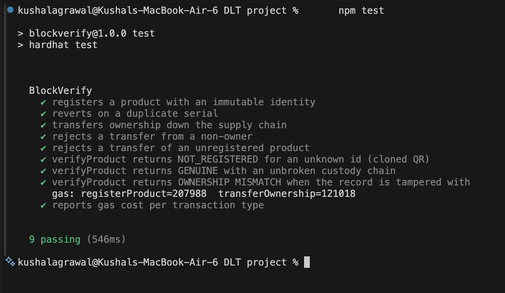

All nine Hardhat/Chai tests pass. They cover registration, duplicate-serial
rejection, multi-hop transfer, unauthorized-transfer rejection, transfer of an
unregistered product, and all three branches of `verifyProduct` —
`NOT REGISTERED`, `VERIFIED GENUINE` and `OWNERSHIP MISMATCH`.

The mismatch branch deserves a note. It is unreachable through the contract's own
functions: no sequence of legitimate calls can make the transfer log disagree
with `currentOwner`. It is therefore tested by forcing node storage directly with
`hardhat_setStorageAt`, the same mechanism used in the tamper experiment of
section 3.5. A branch that cannot be reached legitimately still has to be proven
correct, because its whole purpose is to fire when something illegitimate has
happened.

### 3.2 Transaction details

**Figure 2 — A mined `transferOwnership` transaction on the local node**

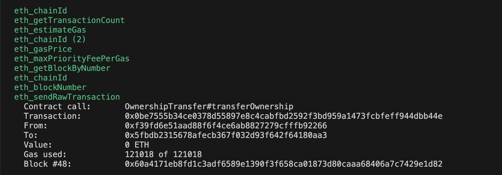

Every ownership change is a signed transaction with a hash, a gas figure and a
block number. The node log distinguishes `eth_sendRawTransaction` — state
changes, which are mined and consume gas — from `eth_call`, the `view` reads used
by verification, which execute locally, cost nothing and appear with no gas or
block number. That distinction is the economic basis of the system: writing
provenance costs gas, reading it does not.

**Figure 3 — Product registration: on-chain write with transaction hash, gas and generated QR code**

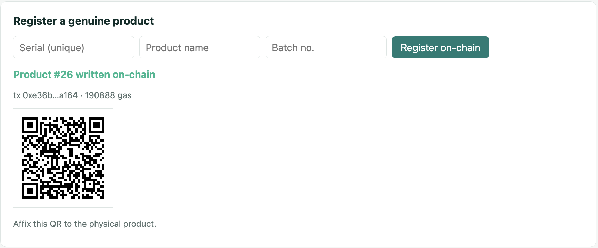

**Figure 4 — Verification: genuine status with the full chain of custody**

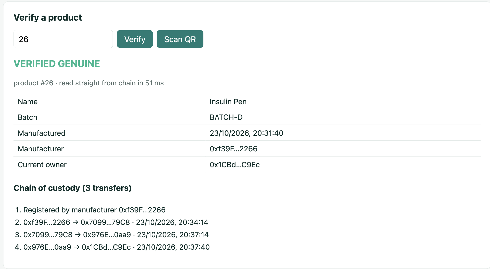

Figure 4 is the system's central output. Product #26 returns `VERIFIED GENUINE`
with its identity fields, its current owner, and all three ownership hops with
on-chain timestamps — Manufacturer → Distributor → Retailer → Customer — read
directly from the chain in 51 ms. Objectives 03, 04 and 05 are all evidenced in
this single result.

**Figure 5 — Verification of an unregistered product ID**

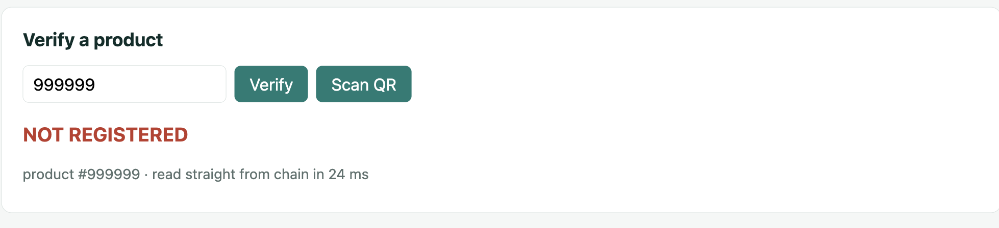

**Figure 6 — Duplicate serial registration rejected by the contract**

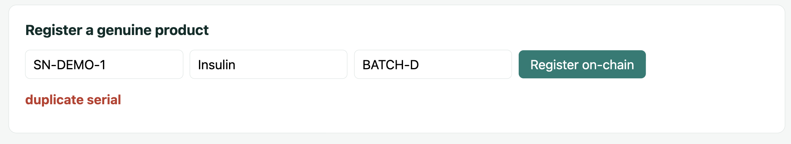

**Figure 7 — Role-based interface: the Distributor portal**

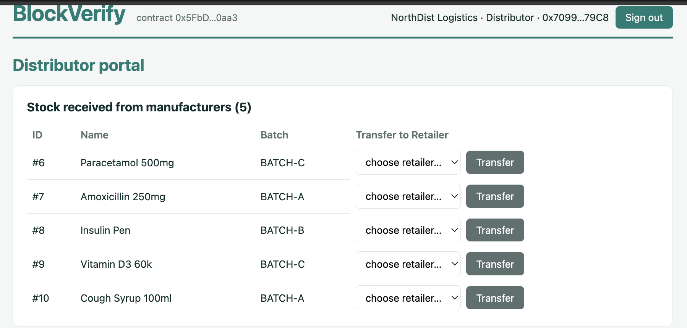

### 3.3 Performance measurements

**Figure 8 — Benchmark output: 30 trials per operation across both systems**

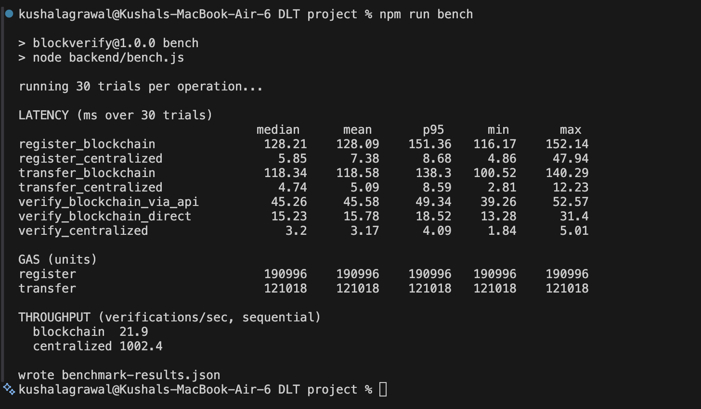

**Table 3 — Operation latency, milliseconds, 30 trials**

| Operation | System | Median | Mean | p95 | Min | Max |
| --- | --- | --- | --- | --- | --- | --- |
| Register | Blockchain | 128.21 | 128.09 | 151.36 | 116.17 | 152.14 |
| Register | Centralized | 5.85 | 7.38 | 8.68 | 4.86 | 47.94 |
| Transfer | Blockchain | 118.34 | 118.58 | 138.30 | 100.52 | 140.29 |
| Transfer | Centralized | 4.74 | 5.09 | 8.59 | 2.81 | 12.23 |
| Verify (via API) | Blockchain | 45.26 | 45.58 | 49.34 | 39.26 | 52.57 |
| Verify (direct read) | Blockchain | 15.23 | 15.78 | 18.52 | 13.28 | 31.40 |
| Verify | Centralized | 3.20 | 3.17 | 4.09 | 1.84 | 5.01 |

**Figure 9 — Median operation latency by system**

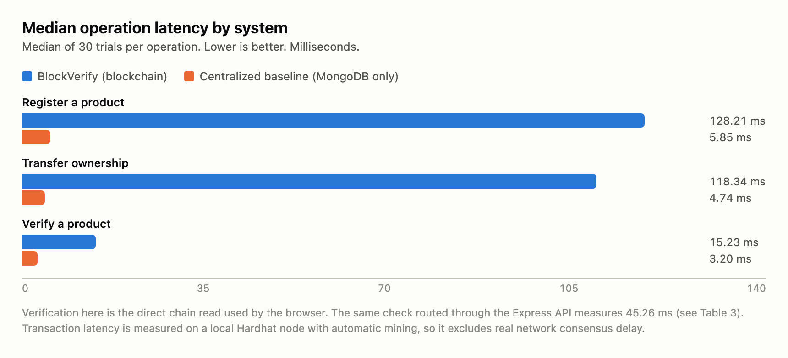

**Table 4 — Gas consumption**

| Operation | Gas | Condition |
| --- | --- | --- |
| Contract deployment | 1,577,877 | one-time |
| `registerProduct` | 207,988 | first registration on a fresh contract |
| `registerProduct` | 190,996 | steady state (benchmark input strings) |
| `registerProduct` | 190,888 | steady state (shorter interface input strings) |
| `transferOwnership` | 121,018 | first transfer of a given product |
| `transferOwnership` | 103,910 | subsequent transfers |
| `getProduct`, `getTransferLog`, `verifyProduct` | 0 | `view` functions |

**Figure 10 — Gas consumption per contract operation**

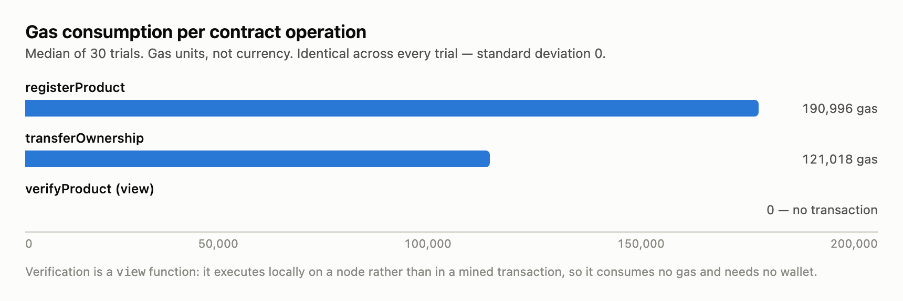

**Figure 11 — Verification throughput**

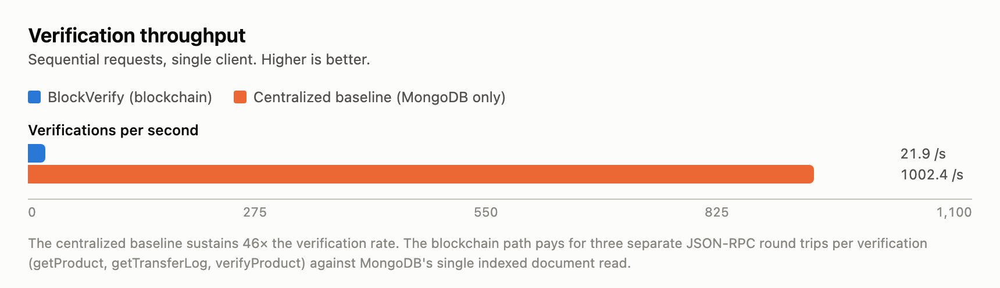

### 3.4 Storage

The on-chain storage layout was read directly from the node rather than inferred.
Each `Product` occupies exactly six 32-byte slots — one per field, with short
strings packed inline into a single slot under Solidity's short-string encoding —
plus one slot for the duplicate-serial guard. Each transfer hop occupies three
slots (`from`, `to`, `timestamp`), with one further slot for the array length.

**Table 5 — Storage per product**

| System | Product record | Each transfer hop | Product with 3 hops |
| --- | --- | --- | --- |
| Blockchain | 7 slots = 224 bytes | 3 slots = 96 bytes | 17 slots = 544 bytes |
| Centralized (MongoDB) | 393 bytes average measured | stored inline in the document | 393 bytes average measured |

### 3.5 Tamper resistance

**Figure 12 — Tamper experiment: four attacks against both systems**

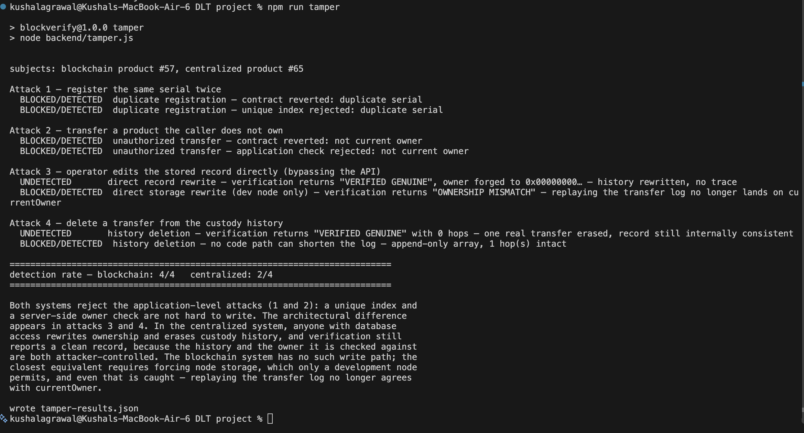

**Figure 13 — Tamper-resistance detection matrix**

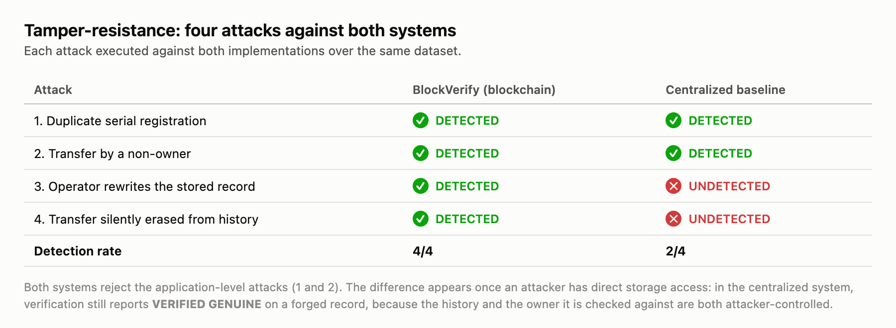

Four attacks were executed against both implementations over the same dataset.
Attacks 1 and 2 operate through the application interface; attacks 3 and 4 assume
an attacker who has reached the storage layer directly — a database administrator,
a compromised server, or a dishonest operator.

**Detection rate: blockchain 4/4, centralized 2/4.**

---

## 4. Comparison

**Table 6 — BlockVerify against the centralized baseline**

| Parameter | BlockVerify (blockchain) | Centralized baseline (MongoDB only) |
| --- | --- | --- |
| Functionality | Register, QR-bind, transfer, verify, audit history | Identical — same API surface and same verification algorithm |
| Register latency (median) | 128.21 ms | 5.85 ms — **21.9× faster** |
| Transfer latency (median) | 118.34 ms | 4.74 ms — **25.0× faster** |
| Verify latency (median) | 15.23 ms direct, 45.26 ms via API | 3.20 ms — **4.8× faster than direct** |
| Verification throughput | 21.9 /s | 1002.4 /s — **46× higher** |
| Transaction cost | 190,996 gas register, 121,018 gas transfer | No per-operation cost |
| Verification cost | 0 gas — `view` function | No cost |
| Storage per product | 224 bytes on-chain, replicated on every node | 393 bytes, single copy |
| Duplicate prevention | Contract revert, enforced by consensus | Unique index, enforced by the database |
| Authorization | `require(currentOwner == msg.sender)`, enforced by every validating node | Server-side check, enforced by application code |
| History mutability | Append-only; no code path shortens the log | Fully mutable by anyone with database access |
| **Tamper detection** | **4/4** | **2/4** |
| Transparency | Any party can audit with only the contract address and a public RPC endpoint | Audit requires trusting the operator's own database |
| Trust requirement | None for reads | Must trust the operator |

---

## 5. Analysis and Interpretation

### 5.1 Why the blockchain path is roughly 20–25× slower, and why the real gap is wider

A write to the contract carries costs the database write does not: transaction
construction, ECDSA signing, an `eth_estimateGas` round trip, a `staticCall`
preflight, broadcast, mining, and a receipt poll. That is six or more JSON-RPC
round trips where MongoDB performs one indexed document write.

The measured gap understates reality. Hardhat Network mines a block the instant a
transaction arrives, so the 128 ms median contains no consensus delay whatsoever.
On Ethereum mainnet a transaction waits roughly 12 seconds for a block, and
several blocks for practical finality; on a Layer-2 such as Polygon, one to two
seconds. The honest statement is therefore that **128 ms is a floor that only a
development network can achieve**, and a production deployment would be three to
four orders of magnitude slower on writes. Any claim that blockchain is
competitive with a database on write latency would be false.

### 5.2 Why verification is the operation that actually matters

Registration and transfer happen once per product per supply-chain hop and are
performed by businesses, which can absorb seconds of latency. Verification
happens every time anyone scans a QR code, is performed by consumers at the point
of sale, and is the only operation where latency is felt by a person waiting.

Verification is also where the architecture is most favourable. It is a `view`
function: it executes locally on a node, is mined into no block, consumes zero
gas, and requires no wallet. At a 15.23 ms median direct read, it is well inside
the threshold at which an interaction feels instantaneous, and it would remain so
on a public network, because a `view` call does not wait for consensus. The
operations that blockchain makes expensive are the infrequent ones; the frequent
one is free and fast. That asymmetry is what makes the design viable at all.

The 45.26 ms figure for verification through the Express API against 15.23 ms for
the direct read is worth noting for a second reason. The browser uses the direct
path, so the API is not merely slower — it is unnecessary, and leaving it out of
the trust path is both the faster and the more trustworthy choice.

### 5.3 Why gas is perfectly deterministic, and what the three register figures mean

Gas showed a standard deviation of exactly zero across all 30 trials. The EVM is
a deterministic state machine with a published cost per opcode; identical input
over identical state costs identical gas. There is no scheduling noise to average
out, which is why a single reading is sufficient for gas where it would be
inadequate for latency.

The three different `registerProduct` figures across our own figures are fully
accountable, and reconciling them demonstrates the cost model rather than
contradicting it:

- **207,988 vs 190,888 — a difference of exactly 17,100.** The first registration
  on a freshly deployed contract takes `productCount` from zero to one. Writing a
  storage slot that currently holds zero costs 20,000 gas against 5,000 for
  updating a non-zero slot, a 15,000 difference, plus 2,100 for the first (cold)
  access to that slot under EIP-2929. 15,000 + 2,100 = 17,100.
- **190,996 vs 190,888 — a difference of exactly 108.** Calldata length. The
  benchmark passed 36 characters across serial, name and batch; the interface
  passed 27. In ABI encoding each additional character replaces a zero padding
  byte, costing 16 gas instead of 4 — a net 12 per character. 9 × 12 = 108.

The same effect explains `transferOwnership` at 121,018 for a product's first
transfer against roughly 103,910 thereafter: the first hop initialises the
transfer log's length slot from zero. The measured premium is 17,108 rather than
exactly 17,100, the residual eight gas being calldata variation between recipient
addresses with differing numbers of zero bytes.

### 5.4 Why storage is smaller on-chain and yet far more expensive

Table 5 shows the on-chain product record at 224 bytes against 393 bytes in
MongoDB — the chain is *more* compact. MongoDB stores field names with every
document in BSON, plus `_id` and Mongoose's `__v`; the contract stores bare
32-byte slots at computed addresses with no field names at all.

Byte count is nonetheless the wrong measure of cost. Those 224 bytes are
replicated on every node in the network and are priced at 20,000 gas per fresh
slot, while MongoDB's 393 bytes exist once. Storage cost here is not a function of
size but of replication and permanence, which is precisely the resource being
bought: the record is expensive *because* many independent parties keep it and
none can quietly discard it.

### 5.5 Why both systems scored 2/4 on the first two attacks

The most important interpretive point in this report is that **blockchain
provided no advantage on attacks 1 and 2.** A unique index rejects a duplicate
serial as reliably as a contract `require`, and a server-side owner check rejects
an unauthorized transfer as reliably as `require(currentOwner == msg.sender)`.
Any claim that a blockchain is needed to prevent duplicate registration is simply
wrong, and our own project proposal came close to implying it.

The advantage appears only against attacks 3 and 4, and only because of who the
attacker is. In the centralized system the verification algorithm is identical to
the contract's — it replays the custody chain and checks that it lands on the
recorded owner — yet it reports `VERIFIED GENUINE` on a forged record. It does so
because both the history it replays and the owner it checks against are
attacker-controlled. **A consistency check is only as trustworthy as the least
trustworthy party who can write to the data being checked.** The algorithm is not
what provides the guarantee; the inability to rewrite the inputs is.

### 5.6 On attack 4 and the integrity of this experiment

Our first implementation of attack 4 erased the custody history but left
`currentOwner` pointing at a forged address. That record is internally
inconsistent, the replay check caught it, and the centralized system appeared to
score 3/4. The attack was unrealistic: a competent insider erases the history
*and* resets the owner to the manufacturer, leaving a record that is internally
consistent and simply says the product never left the factory. Re-run that way,
the attack goes undetected and the score is 2/4.

We record this because the weaker attack flattered our own hypothesis. An
evaluation that only tests attacks the system survives measures nothing.

### 5.7 What the blockchain result does and does not prove

Attack 3 against the blockchain was carried out with `hardhat_setStorageAt`,
which forces a storage slot directly. This is worth stating plainly: **a public
Ethereum network offers no such facility.** Changing a deployed contract's
storage there requires rewriting history against the network's consensus. The
attack is possible here only because a development node deliberately exposes it
for testing.

What the result shows is therefore narrower but still meaningful: even granting
an attacker a power no real network grants, the forged record is *detected* —
`verifyProduct` returns `OWNERSHIP MISMATCH` because the transfer log no longer
leads to `currentOwner`. The verification algorithm fails safe rather than fails
silent. Attack 4 is the stronger structural result: the transfer log is an
append-only array, and no code path in the contract shortens it, so erasing a hop
is not an attack the contract will perform at any privilege level.

---

## 6. Strengths

**Verification requires no trust in us.** `frontend/src/chain.js` reads the
contract directly over JSON-RPC. The Express API can be shut down entirely and
verification still works. Any third party with the contract address and a public
RPC endpoint can audit any product without an account, an API key or our
cooperation. In the centralized baseline, an audit is a request to the operator
to show their own records.

**Verification is free and fast.** Zero gas, no wallet, 15.23 ms median — the
operation consumers perform is the one the architecture makes cheapest.

**History is append-only by construction, not by policy.** No contract function
shortens the transfer log. This is a property of the code, not an access-control
rule that an administrator can be persuaded to bypass.

**Verification never trusts a stored flag.** `verifyProduct` re-derives
authenticity by replaying the custody chain, so a broken chain returns
`OWNERSHIP MISMATCH` rather than a cached "genuine" boolean.

**The QR carries a pointer, not a claim.** Encoding only
`{contractAddress, productId}` means every scan forces a fresh chain read, so
forging the label gains an attacker nothing — the label is not the evidence.

**Gas costs are fully accounted.** Every figure in Table 4 reconciles to the EVM
cost model to the exact gas unit, rather than being reported as an observation.

**Hardware-free.** Any phone camera is a verification terminal; no RFID or NFC
infrastructure is required at any point in the chain.

---

## 7. Limitations

**Write performance is 20–25× worse, and that understates it.** As section 5.1
sets out, the local network contributes no consensus delay. A production
deployment would be seconds per write, not milliseconds.

**Throughput is 46× lower for verification.** 21.9 /s against 1002.4 /s. Our
verification makes three separate JSON-RPC calls — `getProduct`,
`getTransferLog`, `verifyProduct` — where one would do.

**The backend holds all private keys.** Signing on behalf of users removes
MetaMask friction from the demonstration, but it means a compromised backend can
transact as any participant. This weakens the decentralisation argument the
project makes, and is a demonstration convenience, not a design we would defend.

**A local network is not a deployment.** Instant finality, no gas price, no
competing transactions, no reorganisations, twenty pre-funded accounts.

**The QR can be copied.** The chain proves a record's integrity; it cannot prove
that the physical object carrying the label is the object the record describes. A
counterfeit bottle bearing a photocopied genuine label still verifies as genuine.
This is the most significant limitation in the system and no amount of
cryptography addresses it.

**Scan context is not checked.** Report 2's design anticipated flagging a copied
label by comparing `currentOwner` against the scanning party. The chain holds the
data to do this, but the interface does not yet implement it, so a label copied
from a genuine product returns `VERIFIED GENUINE` with the true owner's address
shown rather than an explicit warning.

**The chain cannot validate what was entered.** Immutability protects a record
after it is written. A manufacturer who registers false batch information has
written false information permanently and verifiably.

**Single-machine measurement.** One host, one client, sequential requests, 30
trials. No concurrent load, no network variance, no multi-node consensus.

---

## 8. Proposed Improvements

**Batch verification into one call.** A `verifyProductFull` returning status,
product and transfer log together would collapse three JSON-RPC round trips into
one and should raise verification throughput materially — the clearest available
performance win, and it requires no architectural change.

**Replace backend-held keys with user-controlled wallets.** MetaMask or
WalletConnect signing would make each participant responsible for their own
transactions and remove the single point of compromise that currently undercuts
the decentralisation claim.

**Deploy to a public test network and re-measure.** Sepolia for Ethereum
semantics, Polygon Amoy for Layer-2 costs. This would replace the floor figures
in Table 3 with representative ones and let gas be converted to actual currency.

**Implement scan-context mismatch detection.** Comparing `currentOwner` against
the scanning party's wallet would turn the copied-label case from a silent
`VERIFIED GENUINE` into an explicit warning, closing the gap noted in section 7.

**Strengthen physical binding.** Tamper-evident packaging, or NFC tags carrying a
signed challenge-response, would address what a printed QR cannot. This is the
only improvement that attacks the system's real residual weakness.

**Move bulk data off-chain with on-chain hashes.** Product images or
certificates belong in IPFS or similar with only a content hash anchored
on-chain, keeping per-product gas flat as records grow richer.

**Report concurrent-load results.** Multiple simultaneous clients, with queueing
behaviour and confirmation times under contention.

**Independent contract audit before any real deployment.** The contract is
small, but it has not been reviewed by anyone outside the team.

---

## 9. Conclusion

The three evaluation gaps recorded in Report 2 are closed. A centralized
MongoDB-only baseline was implemented, both systems were benchmarked over 30
trials per operation with distributions reported, and four attacks were executed
against each.

The headline numbers are that the centralized system is 21.9× faster to register,
25.0× faster to transfer and sustains 46× the verification throughput, while
BlockVerify detects 4 of 4 tamper attacks against the baseline's 2 of 4. The
project's original framing — that blockchain is better for this problem — is not
what the data supports. What it supports is narrower and more defensible:
**blockchain costs roughly an order of magnitude in write latency and throughput,
and buys detection of exactly the attack class a centralized system structurally
cannot detect, namely tampering by whoever controls the storage.**

Three findings were not anticipated when the project was proposed. First, a
blockchain provides no advantage at all against duplicate registration or
unauthorized transfer — a unique index and a server-side check handle both, and
claiming otherwise would be wrong. Second, the verification algorithm is not what
provides the guarantee; both systems run the identical replay check and the
centralized one still certifies a forged record, because a consistency check is
only as trustworthy as the least trustworthy party who can write to its inputs.
Third, the economics are favourable in exactly the right place: the expensive
operations are the infrequent business-side writes, while the operation consumers
perform constantly costs no gas and completes in 15 ms.

The residual weakness is not cryptographic. A QR label can be photocopied onto a
counterfeit product, and no property of the chain prevents it. BlockVerify
guarantees that a product's recorded history has not been altered since it was
written; it does not guarantee that the object in a customer's hand is the object
that history describes. Closing that gap requires physical measures —
tamper-evident packaging or secure item-level identifiers — and is the honest
boundary of what this system achieves.
